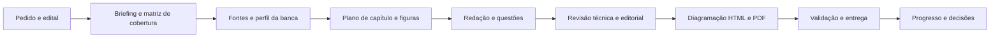

# Arquitetura de execução e informação

## Decisão inicial

O produto começa como um repositório editorial operado por um agente. Isso permite melhorar o método antes de construir um serviço de geração. O conteúdo estruturado e as ferramentas de publicação devem permanecer independentes do provedor de IA.

## Camadas

| Camada | Responsabilidade | Formato |
|---|---|---|
| Instruções | regras permanentes e roteamento | AGENTS.md e .agents/skills/ |
| Planejamento | entregas, dependências e decisões | docs/, Progress.md, Decisions.md |
| Evidências | edital, fontes, prova, gabarito e permissões | registros estruturados e originais privados |
| Conteúdo | texto original, figuras e itens com IDs estáveis | Markdown, SVG, JSON |
| Publicação | conversão e estilos | Pandoc + CSS; Chromium no protótipo |
| Controle | integridade, navegação e revisão humana | Python + relatórios de validação |
| Memória | contexto pessoal e continuidade | Segundo Cérebro; sem cópia pública |

## Contratos e rastreabilidade

Briefing → IDs de itens do edital → objetivos de aprendizagem → capítulos → questões. Toda questão real liga a um registro de prova e gabarito. Toda figura liga a um propósito e registro de direitos. Toda entrega registra versão das instruções e ferramentas, data de conferência e resultado das validações.

IDs persistem entre revisões: `CAP-001`, `FIG-001`, `Q-AUT-001`, `Q-REAL-001`; âncoras de exportação `q-aut-001`, `res-q-aut-001`. Não usar posição na página como identidade. Evitar renumeração automática que quebre links antigos.

## Publicação

Markdown é a fonte editorial. HTML acessível serve à leitura e à revisão; PDF A4 serve à distribuição. No protótipo, scripts/build_sample.py converte uma amostra com Pandoc, incorpora a figura SVG e imprime com Chromium via Playwright. O pipeline genérico, com equações, referências cruzadas, paginação e validação acessível, permanece planejado. Avaliar Typst/Pandoc no piloto se a impressão do navegador limitar o resultado.

## Integrações

GitHub versiona a base. Drive armazena notas de gestão e entregas quando autorizado. Uma escrita em um sistema não prova sincronização do outro: confirmar cada destino por leitura. Sem espelhamento integral do cofre, upload automático de documentos privados, credenciais no Git ou scheduler neste estágio.

## Evolução para serviço

Somente após o piloto: avaliar CLI de produção, modelo de tarefas, armazenamento de artefatos e adaptador de LLM. Se houver aplicação multiusuário, então definir autenticação, custos, quotas, isolamento de arquivos e recuperação de tarefas. A plataforma e o provedor dependem de uma necessidade demonstrada; não estão escolhidos agora.
