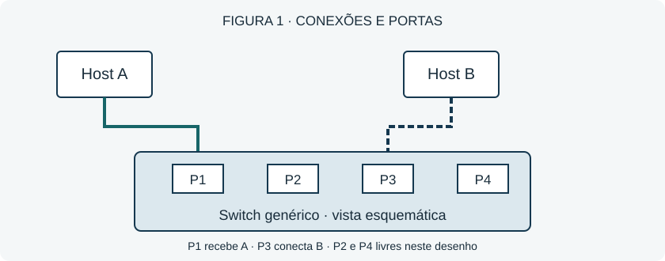

# Switch: da porta ao encaminhamento {#cap-001}

## Objetivo e ponto de partida

Ao final, identifique as portas do esquema e diferencie aprendizagem de encaminhamento. Considere uma rede local com uma única VLAN, sem filtros adicionais.

## Entenda o mecanismo

Um switch Ethernet liga dispositivos e encaminha quadros. Ele aprende o endereço MAC de origem de um quadro pela porta de entrada. Para encaminhá-lo, consulta o endereço MAC de destino na tabela: aprender e escolher a saída são operações distintas.

Na Figura 1, A entra por P1; B está em P3. Os conectores desenhados representam portas Ethernet. A disposição é ilustrativa e não define características de um modelo real.

> **Conceito:** a tabela associa endereços MAC a portas e VLANs; ela é aprendida pelo tráfego de origem, quando a aprendizagem dinâmica está habilitada.

## Exemplo resolvido

A envia um quadro unicast para B por P1. Se a tabela já associa B a P3, o switch encaminha o quadro por P3. Se o destino ainda for desconhecido, pode replicá-lo pelas outras portas elegíveis da mesma VLAN. Considere portas em encaminhamento e sem restrições adicionais.

Para conferir: P1 é entrada; a saída depende da informação sobre B, e não da posição física do computador no desenho.

## Recupere sem consultar

Qual endereço ensina ao switch onde está o remetente? Qual endereço ele consulta para selecionar a saída?
