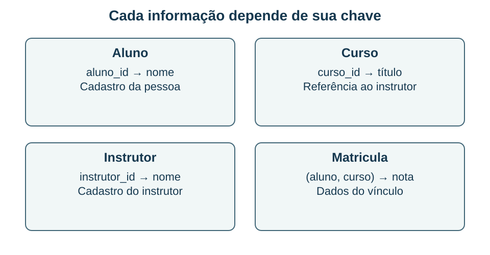

## Dependências e anomalias de atualização {#bd03}

**Objetivo BD-03 — item 3:** identificar dependências funcionais e normalizar uma estrutura justificando o que cada decomposição resolve.

Considere `Matricula(aluno_id, curso_id, nome_aluno, titulo_curso, instrutor_id, nome_instrutor, nota)`. Neste exemplo, a chave é `(aluno_id, curso_id)`, cada curso possui um instrutor e cada instrutor possui um único nome cadastrado. Essas hipóteses são indispensáveis: dependências funcionais derivam das regras do domínio, e não apenas da coincidência de valores em uma pequena tabela.

Uma dependência funcional `X → Y` diz que duas linhas com o mesmo X não podem ter valores diferentes de Y. A regra `aluno_id → nome_aluno` não significa que o nome identifica o aluno; pessoas diferentes podem ter o mesmo nome. A direção da seta importa. Uma superchave determina todos os atributos; uma chave candidata é uma superchave mínima.

Repetir o nome de Ana em muitas matrículas causa **anomalia de atualização**: corrigir apenas uma linha deixa versões conflitantes. Se só pudermos cadastrar um curso quando alguém se matricular, surge anomalia de inserção. Se excluir a última matrícula apagar a única informação sobre um curso, surge anomalia de exclusão. A normalização organiza dependências para reduzir esses problemas.

### Da 1FN à 3FN

Na **primeira forma normal**, os valores são tratados como unitários nos domínios adotados, sem grupos repetitivos representando várias ocorrências na mesma célula. Uma lista `SQL, Modelagem` usada para representar cursos deve ser modelada conforme o relacionamento, em vez de ser confundida com uma matrícula única. “Atômico” depende do domínio e das operações; não significa que todo texto deva ser dividido em caracteres.

Na **segunda forma normal**, estando em 1FN, atributos não primos não podem depender de parte própria de uma chave candidata. No exemplo, `nome_aluno` depende apenas de `aluno_id`, e os dados do curso dependem apenas de `curso_id`. Há dependências parciais em relação à chave composta. Separar apenas `nota` não resolve o problema.

Na **terceira forma normal**, para cada dependência funcional não trivial `X → A`, X deve ser superchave ou A deve ser atributo primo, isto é, pertencer a alguma chave candidata. A regra didática “eliminar dependências transitivas de atributos não chave” ajuda em casos simples, mas a definição formal evita erros quando existem várias chaves candidatas.

### Exemplo resolvido: decompor com fundamento

**Passo 1:** separar `Aluno(aluno_id, nome_aluno)` e `Curso(curso_id, titulo_curso, instrutor_id, nome_instrutor)`. `Matricula(aluno_id, curso_id, nota)` conserva a informação que depende do vínculo inteiro. Isso elimina as dependências parciais mencionadas.

**Passo 2:** em Curso, `curso_id → instrutor_id → nome_instrutor`. Criamos `Instrutor(instrutor_id, nome_instrutor)` e mantemos em Curso a referência ao instrutor. Agora o nome do instrutor é atualizado em seu cadastro, sem percorrer todos os cursos. As chaves estrangeiras preservam as ligações entre as relações.

**Conferência:** devemos reconstruir as informações por junções sem inventar combinações, e preservar as dependências importantes ou saber onde validá-las. Uma decomposição não é boa apenas por gerar tabelas menores. A propriedade de **junção sem perda** evita linhas espúrias na reconstrução; a preservação de dependências permite conferir regras sem necessariamente reunir tudo novamente.

### BCNF e limites da simplificação

Na **BCNF**, todo determinante de dependência funcional não trivial deve ser superchave. Ela é mais restritiva que a 3FN. Uma relação pode estar em 3FN e violar BCNF quando o atributo dependente é primo e o determinante não é superchave. Em `R(aluno, disciplina, professor)`, suponha `(aluno, disciplina) → professor` e `professor → disciplina`. As chaves candidatas são `(aluno, disciplina)` e `(aluno, professor)`: a segunda dependência pode satisfazer a exceção da 3FN, mas viola BCNF.

Formas superiores tratam outras dependências: a 4FN aborda dependências multivaloradas não triviais, e a 5FN, dependências de junção. Elas não devem ser confundidas com a regra de dependência parcial da 2FN. Normalização também não promete o menor tempo de consulta: desnormalizações analíticas podem ser deliberadas, com controle de consistência.

**Recupere:** por que trocar uma chave composta por um número artificial não elimina, por si só, as dependências de negócio? Resolva novamente a decomposição sem olhar o diagrama.

**Fontes:** F02; P26, item 46. As dependências e os nomes deste exemplo foram definidos para ensinar o mecanismo, sem reproduzir o enunciado da prova.
