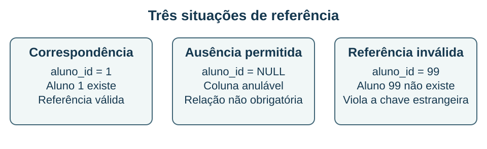

## Chaves estrangeiras e efeitos das alterações {#bd04}

**Objetivo BD-04 — item 4:** distinguir integridade de entidade, de domínio e referencial e prever o efeito de excluir ou alterar um registro referenciado.

Uma matrícula que aponta para um aluno inexistente cria uma associação sem significado no cadastro. A **integridade referencial** evita esse tipo de referência inválida: valores de uma chave estrangeira devem corresponder a uma chave referenciada, conforme as regras do SGBD e o tratamento de NULL. A associação é uma restrição de consistência; não é apenas uma convenção escrita no nome de uma coluna.

A **integridade de entidade** exige identificação adequada das linhas, normalmente por chave primária única e não nula. Restrições de **domínio** limitam valores admissíveis, por tipos, condições e outros mecanismos. Uma chave estrangeira não garante que uma nota esteja entre zero e dez; essa é outra regra. Uma coluna chamada `aluno_id` também não se torna chave estrangeira apenas por seu nome.

### NULL e restrições diferentes

Em uma chave estrangeira simples que admite NULL, a ausência do valor normalmente não exige correspondência na tabela referenciada. Para tornar a relação obrigatória, usamos também `NOT NULL`. Em chaves compostas, regras como MATCH SIMPLE e MATCH FULL exigem atenção ao conjunto de componentes; não generalize uma regra observada em uma coluna para toda combinação possível.

`UNIQUE`, `PRIMARY KEY`, `NOT NULL` e `CHECK` têm finalidades diferentes. O tratamento de NULL em restrições UNIQUE varia entre implementações e opções. No PostgreSQL, uma condição CHECK que resulta em desconhecido não equivale a falso: um `CHECK(nota >= 0)` isolado não substitui `NOT NULL`. Aqui, a declaração de hipótese é parte da resolução correta.

### Exclusão e atualização da chave referenciada

Se um aluno tem matrículas, o que ocorre ao excluí-lo depende da política declarada. **ON DELETE CASCADE** propaga a exclusão para as linhas que o referenciam. **ON DELETE SET NULL** preserva as linhas dependentes e torna a referência nula, se as demais restrições permitirem. **SET DEFAULT** tenta atribuir o padrão, que ainda precisa satisfazer a chave estrangeira. Não é uma autorização para manter qualquer valor inválido.

**NO ACTION** exige que a restrição esteja satisfeita quando for conferida; em sistemas com restrições adiáveis, a conferência pode ser postergada quando configurada. **RESTRICT** pode impedir a operação sem essa possibilidade de adiamento. Os detalhes dependem do SGBD. Em uma situação simples sem adiamento, ambas podem impedir a exclusão de uma linha ainda referenciada. A direção da cascata vai da linha referenciada para as dependentes; apagar uma matrícula não significa apagar automaticamente o aluno.

As políticas `ON UPDATE` tratam mudanças na chave referenciada. Alterar uma coluna qualquer do aluno, como seu nome, não é o mesmo que alterar o identificador usado pela chave estrangeira. O enunciado precisa dizer o que está mudando.

### Exemplo resolvido: excluir um curso

Existem `Curso(10, 'SQL')` e duas matrículas para o curso 10. **Cenário A:** a referência usa ON DELETE CASCADE. Ao excluir o curso, são excluídas as duas matrículas que o referenciam; os alunos continuam em Aluno. **Cenário B:** a referência usa NO ACTION, sem adiamento e sem outra operação que remova a referência. A exclusão do curso falha e os dados permanecem consistentes.

**Conferência:** a chave estrangeira foi declarada em Matricula, apontando para Curso. Logo, o evento inicial ocorre em Curso. Inverter essa direção produz a conclusão errada de que excluir uma matrícula deveria excluir o curso. A regra técnica deve refletir uma decisão de negócio: apagar histórico por cascata pode ser inadequado, mesmo quando a sintaxe é válida.

Índices são outra decisão. No PostgreSQL, a chave primária cria um índice de suporte, mas declarar a chave estrangeira não cria automaticamente um índice na coluna que referencia outra tabela. Esse índice pode ser útil para localizar dependentes; sua necessidade não altera a definição lógica da restrição.

**Recupere:** explique por que uma chave estrangeira anulável não torna a matrícula obrigatoriamente associada a um aluno, e por que CASCADE não é uma operação simétrica.

**Fontes:** F03; P26, item 47. Recursos de adiamento e índices foram descritos com referência explícita ao PostgreSQL, sem atribuí-los a todos os produtos.
