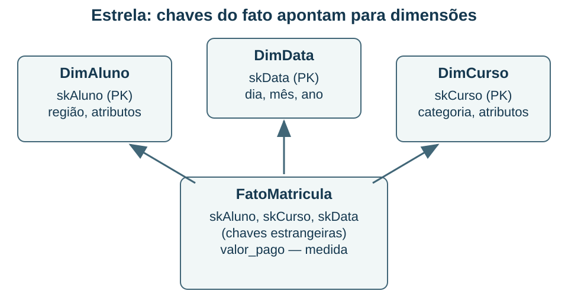

## Definir o grão antes de somar {#bd06}

**Objetivo BD-06 — item 6:** construir e avaliar fatos, dimensões, grão, medidas e histórico em um modelo dimensional.

Antes de escolher colunas para uma tabela de fatos, complete a frase: “cada linha representa...”. Essa definição é o **grão**. Pode ser uma matrícula individual, uma venda de item, o saldo diário de uma conta ou o total mensal de um curso. Misturar esses níveis na mesma medida sem uma regra clara pode contar um mesmo evento mais de uma vez.

Na escola deste material, uma linha de `FatoMatricula` representa uma matrícula individual. A tabela guarda referências para dimensões como Aluno, Curso e Data, além de medidas como valor pago. As **dimensões** descrevem contextos de análise: categoria do curso, região do aluno e mês. As chaves estrangeiras da tabela de fatos apontam para as chaves das dimensões. Não é necessário inserir em cada dimensão as chaves de todas as outras.

O diagrama é um **esquema em estrela**: dimensões diretamente ligadas à tabela de fatos. No **floco de neve**, parte da estrutura dimensional é normalizada em outras tabelas. A estrela pode simplificar consultas; o floco de neve pode reduzir certas redundâncias. Nenhuma escolha vence por definição: há efeitos sobre manutenção, compreensão e desempenho que precisam ser avaliados.

### Medidas e agregações

Uma medida **aditiva** pode ser somada nas dimensões relevantes; receita de eventos distintos costuma ter essa propriedade quando moeda e critérios são compatíveis. Uma medida **semiaditiva**, como saldo, pode ser agregada em certos eixos e não simplesmente somada ao longo do tempo. Uma medida **não aditiva**, como uma razão, exige uma forma apropriada de recomposição.

Suponha duas turmas: uma tem média 6 com dez alunos; outra, média 9 com vinte. A média conjunta não é `(6 + 9)/2 = 7,5`, pois os grupos têm tamanhos diferentes. É `(6×10 + 9×20)/30 = 8`. Guardar numerador e denominador pode permitir agregações corretas. O mesmo cuidado vale para percentuais e indicadores de aprovação.

### Exemplo resolvido: evitar contagem duplicada

Uma matrícula possui três parcelas. Se `FatoMatricula` tem uma linha por matrícula e `FatoPagamento` tem uma por parcela, juntar as duas tabelas diretamente pode repetir o valor total da matrícula três vezes. **Diagnóstico:** os fatos têm grãos diferentes. **Solução possível:** agregar pagamentos ao grão da matrícula antes de combinar resultados, ou analisar cada fato por dimensões compatíveis. Trocar SUM por DISTINCT sem entender o domínio não resolve o problema geral: dois eventos legítimos podem ter o mesmo valor.

Outro cuidado é o **histórico das dimensões**. Uma aluna muda de região. Se sobrescrevermos sua região no cadastro analítico, relatórios antigos podem passar a atribuir suas matrículas à região atual. Na estratégia de dimensão lentamente mutável tipo 1, a alteração substitui o valor. No tipo 2, são mantidas versões com vigência e uma chave substituta por versão. A política deve dizer se o relatório quer o contexto da época ou o contexto atual.

**Conferência:** quando o fato referencia uma versão histórica, a chave dessa versão precisa permanecer rastreável. A simples existência de colunas de início e fim não garante intervalos corretos; sobreposições e ausência de versão aplicável devem ser tratadas na carga.

**Recupere:** escreva o grão de uma tabela de “saldo por conta e dia” e explique por que somar seus saldos de segunda a sexta não calcula automaticamente o saldo da semana. Depois desenhe as chaves estrangeiras de uma estrela sem inverter sua direção.

**Fontes:** F08 e P26, item 49. A discussão de dimensões lentamente mutáveis é uma técnica de preservação de contexto, não uma previsão de cobrança.
