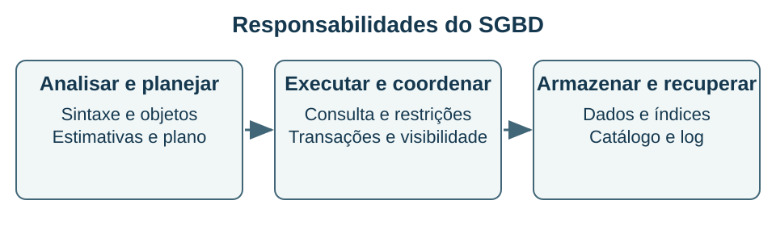

## O sistema que organiza o acesso aos dados {#bd10}

**Objetivo BD-10 — item 10:** distinguir banco, SGBD e aplicação e reconhecer os principais serviços de processamento, armazenamento e recuperação.

O **banco de dados** é o conjunto organizado de dados e estruturas. O **SGBD**, sistema gerenciador de banco de dados, é o software que administra esse conjunto e oferece operações, restrições, controle de concorrência e outros serviços. Uma aplicação usa o SGBD para realizar tarefas de negócio. Esses conceitos se relacionam, mas não são sinônimos: trocar a tela da aplicação não significa trocar o modelo de dados ou o gerenciador.

Uma **instância** pode designar o ambiente de execução do produto, com processos e memória, enquanto os bancos são conjuntos de objetos administrados. O significado exato varia entre fornecedores; evite atribuir a terminologia específica de um produto a todos os demais. Um SGBD pode operar como servidor separado, estar embutido na aplicação ou ser oferecido como serviço gerenciado.

O desenho representa responsabilidades, não uma disposição física obrigatória de processos. Em um produto real, componentes podem estar combinados ou distribuídos. O objetivo é reconhecer por que executar uma consulta envolve mais do que ler um arquivo de texto.

### Caminho de uma consulta

O analisador verifica sintaxe e resolve referências a objetos. O planejador ou otimizador compara estratégias possíveis, usando estatísticas e estimativas de custo. O executor realiza o plano escolhido, consultando páginas, índices e estruturas intermediárias. O resultado pode ser afetado por permissões, regras de visibilidade e restrições, que também fazem parte da administração do acesso.

Um **buffer** mantém páginas em memória para reduzir leituras de armazenamento. Não deve ser confundido com um banco cujo conjunto de dados principal foi projetado para residir em memória. Um **índice** mantém uma estrutura de acesso, como uma árvore ordenada em implementações comuns, para localizar dados sem percorrer necessariamente todas as linhas. O benefício depende de seletividade, volume, distribuição e operações executadas.

O catálogo descreve objetos e estatísticas. O log de recuperação registra informações usadas para manter ou recuperar a consistência conforme o projeto do SGBD. No PostgreSQL, o mecanismo WAL relaciona a gravação do log à recuperação. Ter um log não elimina a necessidade de backup e de uma estratégia de restauração testada.

### Exemplo resolvido: escolher um caminho de acesso

Uma tabela possui um milhão de matrículas. Consultar um aluno específico pode beneficiar-se de um índice em aluno_id. Consultar quase todas as matrículas para produzir um relatório global pode tornar uma varredura sequencial competitiva. **Raciocínio:** o índice evita localizar muitas linhas quando o filtro é seletivo; quando quase todas serão lidas, as buscas e acessos adicionais podem custar mais.

**Conferência:** compare planos e medidas com uma carga representativa, em vez de concluir que “usar índice é sempre mais rápido”. Uma estimativa do otimizador não é o tempo efetivamente medido. No PostgreSQL, EXPLAIN mostra o plano; EXPLAIN ANALYZE executa a instrução para coletar medidas. Isso merece cuidado quando a instrução altera dados, pois não é uma inspeção puramente inofensiva.

### Objetos e responsabilidades

Tabelas armazenam relações; visões apresentam consultas nomeadas; restrições expressam regras; índices apoiam acesso. Procedimentos, funções e gatilhos oferecem mecanismos adicionais, conforme o produto. Controle de acesso distingue identidades e permissões. A administração precisa considerar disponibilidade, crescimento, cópias, restauração e observação do funcionamento, sem presumir que um produto gerenciado retire todas as responsabilidades da organização.

**Recupere:** diferencie arquivo de dados, índice, catálogo e log. Explique por que uma consulta correta pode ser lenta e por que uma consulta rápida pode continuar errada para o objetivo de negócio.

**Fontes:** F03, F05, F07 e F17. Os componentes são uma visão didática; particularidades foram atribuídas ao PostgreSQL quando necessário.
