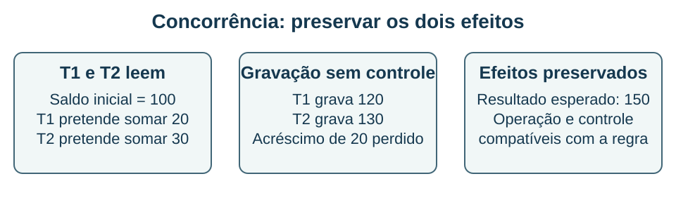

## Transações, consistência e concorrência {#bd11}

**Objetivo BD-11 — item 11:** interpretar propriedades transacionais, reconhecer anomalias de concorrência e separar garantias lógicas de decisões de implantação.

O conjunto **ACID** resume propriedades de transações. **Atomicidade** significa tratar a unidade de trabalho como um todo: suas alterações são efetivadas ou desfeitas conforme o mecanismo transacional. **Consistência** relaciona a transação às regras válidas do banco; ela não descobre automaticamente todas as regras de negócio que nunca foram declaradas ou implementadas. **Isolamento** controla interferências entre transações concorrentes. **Durabilidade** trata da preservação de efeitos confirmados sob o modelo de falhas e a configuração do sistema.

Replicação não substitui backup: uma exclusão indevida pode alcançar as réplicas. Recuperar um estado anterior exige cópias e política de recuperação. A relação entre confirmação ao cliente e gravação durável depende da configuração do produto.

### Anomalias e níveis de isolamento

Uma **leitura suja** observa alteração ainda não confirmada de outra transação. Uma **leitura não repetível** ocorre quando a releitura de uma linha pode observar um valor diferente por alteração concorrente confirmada. Um **fantasma** envolve mudança no conjunto de linhas que satisfaz um predicado. Uma **atualização perdida** pode ocorrer quando operações concorrentes sobrescrevem resultados sem o controle necessário.

A classificação tradicional inclui READ UNCOMMITTED, READ COMMITTED, REPEATABLE READ e SERIALIZABLE. É preciso distinguir as garantias mínimas da classificação e o comportamento de uma implementação. No PostgreSQL, READ UNCOMMITTED se comporta como READ COMMITTED; REPEATABLE READ usa uma visão consistente e impede fantasmas na implementação, mas ainda pode exigir cuidado com anomalias de serialização. SERIALIZABLE pode abortar uma transação para preservar a garantia, exigindo tratamento e nova tentativa pela aplicação.

**Fontes:** F07 e F16. As ressalvas sobre níveis foram conferidas na documentação da versão 17 do PostgreSQL.

### Exemplo resolvido: perda de atualização

T1 e T2 leem saldo 100 e calculam, fora do banco, acréscimos de 20 e 30. Depois gravam valores absolutos: T1 grava 120; T2 grava 130 por último. O saldo final perde o acréscimo de 20. O problema é a sobreposição das gravações.

Uma atualização relativa, como `SET saldo = saldo + 20`, pode usar os mecanismos de concorrência do SGBD para evitar esse padrão. Outras soluções incluem bloqueio explícito ou verificação de versão, conforme o produto e a regra. Invariantes que abrangem várias linhas ainda precisam de análise própria: não há garantia automática de serialização de qualquer sequência de decisões.

**Conferência:** com os dois acréscimos corretamente preservados, o saldo esperado é 150. Se uma transação falhar por conflito, a aplicação deve tratar o resultado; ignorar a falha e mostrar “sucesso” não preserva a regra pretendida.

### Consistência em sistemas distribuídos

Em sistemas distribuídos, “consistência” também designa garantias de observação entre réplicas, diferentes da letra C de ACID. CAP trata da tensão entre requisitos específicos de consistência e disponibilidade sob partição de rede. Não significa “qualquer banco escolhe duas letras” nem ausência de transações em NoSQL.

**Independência entre níveis:** criar um índice é uma mudança física que não deveria alterar o significado das consultas. Mudar o esquema lógico pode exigir adaptação das aplicações ou uso de visões. A independência é um objetivo apoiado por mecanismos do SGBD, não garantia de mudanças sempre invisíveis.

**Recupere:** associe cada falha à garantia em discussão: metade de uma transferência efetivada, leitura de valor ainda não confirmado e perda de dados confirmados após uma falha. Explique por que “usar transação” ainda exige escolher e compreender o isolamento.

