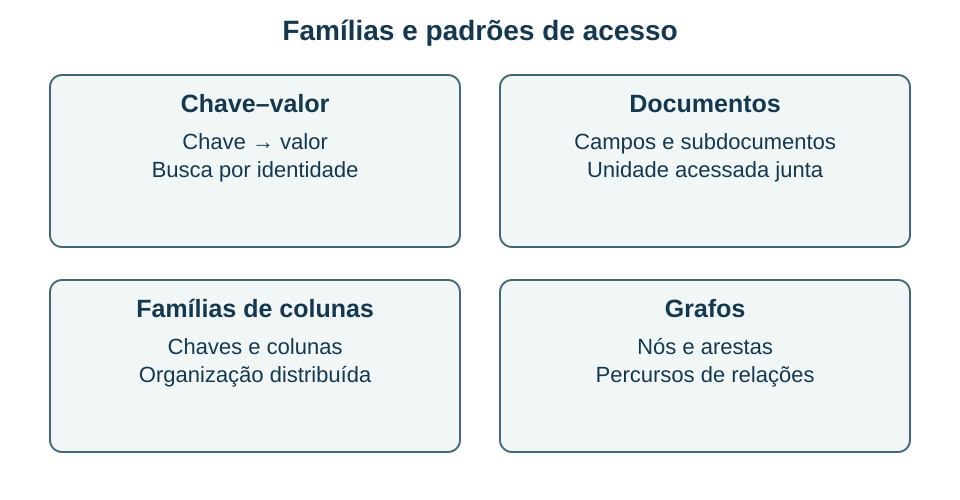

## Escolher uma organização compatível com o acesso {#bd12}

**Objetivo BD-12 — item 12:** distinguir famílias NoSQL, justificar uma escolha por requisitos e evitar generalizações sobre esquema e transações.

**NoSQL** reúne diferentes organizações de dados e produtos; não descreve um único modelo universal. É comum encontrar as famílias chave–valor, documentos, famílias de colunas e grafos. As necessidades de consulta, atualização, distribuição, consistência e governança devem orientar a escolha. A afirmação “NoSQL é sempre melhor para muitos dados” omite justamente os requisitos que permitem comparar soluções.

Em um modelo **chave–valor**, uma chave localiza um valor. É útil para acessos que já conhecem essa chave, como recuperação de uma sessão. No modelo de **documentos**, uma unidade pode representar um objeto composto, com campos, subdocumentos e coleções. No modelo de **famílias de colunas**, a organização favorece certos padrões de armazenamento e acesso distribuído, conforme o produto. Em **grafos**, nós e arestas com propriedades tornam explícitas entidades e relações que precisam ser percorridas.

O desenho é uma comparação conceitual. Ele não afirma que todos os produtos de uma família tenham as mesmas operações, garantias ou limites. Um produto pode combinar recursos de mais de um modelo.

### Flexibilidade não significa ausência de regras

No MongoDB, documentos de uma coleção podem ter conjuntos de campos diferentes, e há recursos de validação de esquema quando necessários. Assim, **esquema flexível** não é sinônimo de “nenhum esquema possível”. A aplicação continua dependendo do significado e dos tipos dos dados que consome.

Uma decisão frequente é **embutir** informações relacionadas em um documento ou manter **referências** entre documentos. Embutir pode favorecer recuperar e atualizar uma unidade que normalmente é acessada em conjunto. Referenciar pode evitar certas duplicações e acomodar relações ou volumes diferentes. É necessário considerar crescimento, frequência de mudanças e garantias de atualização, em vez de transformar uma preferência em regra absoluta.

### Exemplo resolvido: unidades consultadas em conjunto

Uma plataforma armazena fichas de equipamentos. Um projetor possui luminosidade e resolução; uma cadeira possui material e dimensões. A leitura mais comum recupera a ficha completa de um único item. Um modelo documental é uma alternativa coerente para guardar atributos distintos na unidade frequentemente acessada.

**Justificativa:** a organização acompanha o padrão de acesso e a variação dos campos. **Limite:** isso não demonstra que um modelo relacional seria impossível. Ele poderia usar tabelas especializadas, estruturas de composição ou recursos para documentos. A escolha precisa ser comparada com outros requisitos, como relacionamentos entre itens, consultas agregadas e regras de integridade.

Para representar uma rede em que a pergunta principal envolve vários saltos entre pessoas e relações, um modelo de grafo pode ser mais natural. Para buscar um token por sua chave, uma solução chave–valor pode ser suficiente. A característica relevante muda conforme a pergunta.

### Garantias e distribuição

Não é correto dizer que todo NoSQL abandona ACID, que toda consulta exige um grafo ou que todo produto usa consistência eventual em qualquer operação. O MongoDB oferece mecanismos transacionais; as garantias de leitura, escrita e distribuição precisam ser examinadas na versão e configuração usadas. Escala horizontal também envolve particionamento, replicação e coordenação, com custos que não desaparecem por mudar a categoria do banco.

**Recupere:** escolha um modelo para um catálogo de fichas heterogêneas e outro para percursos de relações, justificando pelo acesso. Depois explique que requisito adicional poderia mudar sua decisão. A resposta boa identifica condições, em vez de afirmar que uma família serve para todos os cenários.

**Fontes:** F10 e F11; P26, item 50, e P24, item 66, como referências de prova. As descrições de produto são exemplos, não requisitos adicionais do edital.
