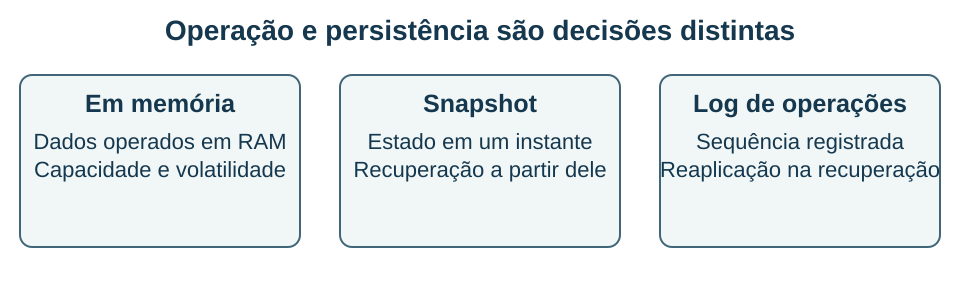

## Onde os dados ficam e como sobrevivem {#bd13}

**Objetivo BD-13 — item 13:** distinguir processamento em memória, cache e persistência e avaliar consequências de uma falha.

Todo banco usa memória em algum grau, mas isso não torna todo SGBD um **banco em memória**. A expressão normalmente descreve uma arquitetura em que o conjunto de dados ou sua representação principal de operação é mantido em RAM. Um banco tradicional também pode usar um buffer extenso para páginas de dados e ainda ter outra organização de armazenamento como base da persistência.

A memória oferece acesso rápido em muitas situações, mas é um recurso finito e, em sua forma usual, volátil. É preciso considerar custo, tamanho do conjunto, pressão de memória, política de remoção e recuperação. “Mais rápido” não é uma garantia independente da carga: rede, serialização, contenção e desenho das operações também influenciam o tempo observado.

### Persistência é uma decisão separada

Um banco em memória pode ter persistência por snapshots, logs ou mecanismos combinados. Portanto, não é correto concluir que “em memória” significa necessariamente “sem armazenamento persistente”. Também não é correto concluir que qualquer configuração de persistência assegura perda zero sob toda falha.

No Redis, a documentação distingue RDB, que produz snapshots em instantes definidos; AOF, que registra operações de escrita para reconstrução; ausência de persistência; e combinação de RDB com AOF. Há escolhas de frequência de gravação e sincronização que alteram custos e garantias. O conteúdo armazenado em uma réplica, por sua vez, não é automaticamente uma cópia histórica capaz de desfazer toda alteração lógica indevida.

### Exemplo resolvido: uma falha entre snapshots

Considere um sistema hipotético que concluiu um snapshot às 10h00 e confirmou novas alterações entre 10h00 e 10h04. Às 10h05, o processo e seu estado volátil são perdidos. Suponha que não exista log persistido nem outro mecanismo de recuperação além daquele snapshot.

**Conclusão:** recuperar o snapshot leva ao estado de 10h00; as alterações posteriores não estão garantidas por ele. Não podemos atribuir a recuperação ao estado de 10h04 apenas porque as respostas foram entregues à aplicação. A regra de persistência definida no problema não sustenta essa conclusão.

Se acrescentarmos um log durável das alterações posteriores e um procedimento correto de reaplicação, o ponto recuperável poderá mudar. A resposta depende do que foi persistido, de como a confirmação se relaciona à sincronização e do tipo de falha considerado. Um intervalo entre snapshots, isoladamente, não descreve todo o sistema quando há outras formas de persistência.

### Cache e fonte de verdade

Um cache guarda dados para acelerar acesso e pode admitir expiração ou remoção. Quando a fonte de verdade está em outro banco, uma falta no cache pode ser atendida consultando a origem. Se o sistema guarda sua única cópia de uma informação no cache e permite removê-la, o comportamento de perda deixa de ser apenas uma questão de desempenho.

Imagine um cadastro de cursos persistido em um SGBD e suas páginas mais acessadas em cache. Remover uma entrada do cache não apaga o cadastro original. Já remover uma informação que só existe no armazenamento volátil exige outra análise. O papel atribuído ao componente precisa estar claro na arquitetura.

**Recupere:** explique por que um banco em memória pode ser persistente e por que ter uma réplica não equivale a ter histórico de restauração. Em seguida, indique quais hipóteses faltam para calcular a perda possível após uma falha.

**Fontes:** F11 e F07. Os horários são de um exercício hipotético; não representam medições ou garantias de um serviço contratado.
