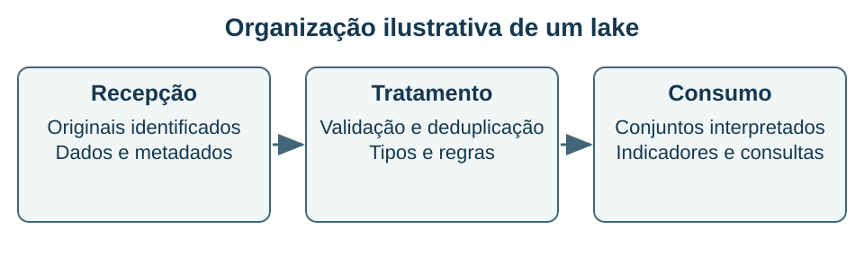

## Armazenar muito não dispensa organizar {#bd14}

**Objetivo BD-14 — item 14:** distinguir data lake, warehouse e soluções de processamento em escala e relacionar formato, catálogo e governança.

Um **data lake** armazena conjuntos de dados de origens e formatos variados, frequentemente em uma base de arquivos ou objetos. Pode receber registros estruturados, documentos, eventos e conteúdo não estruturado. A possibilidade de conservar dados em formas próximas à origem favorece novos usos, mas não garante que o conteúdo esteja pronto para análise ou que possa ser encontrado e interpretado sem trabalho adicional.

Um **data warehouse** organiza dados para análise integrada, com definições, estruturas e controles apropriados às perguntas de negócio. A oposição didática entre schema-on-read e schema-on-write descreve tendências: interpretar parte da estrutura na leitura ou impor estrutura durante a preparação e carga. Não significa que um lake nunca tenha esquema, que um warehouse nunca receba conteúdo semiestruturado ou que governança seja opcional em algum dos dois.

### Formatos e processamento

CSV representa registros textuais delimitados; JSON representa estruturas como objetos e listas; Parquet é um formato colunar. Uma organização por colunas pode beneficiar consultas que leem algumas colunas de muitos registros, com oportunidades de compressão e redução de leitura. Isso não torna Parquet um SGBD nem garante que toda consulta será mais rápida.

Em grandes volumes, particionar arquivos por atributos adequados pode evitar leituras desnecessárias. Partições muito pequenas, distribuições desequilibradas e excesso de arquivos também podem prejudicar a operação. O esquema de partições deve ser avaliado com padrões de acesso, tamanho e atualização, em vez de ser escolhido pelo maior número possível de divisões.

A figura usa camadas como um recurso didático, não como um requisito único de todo lake. Guardar dados brutos preserva uma origem útil para reprocessar, mas não autoriza acesso indiscriminado ou retenção sem critério. Catálogo, linhagem, responsáveis, regras de qualidade e permissões ajudam a evitar um repositório em que ninguém sabe o que está armazenado.

### Exemplo resolvido: receber eventos e produzir indicador

Uma plataforma recebe eventos de matrícula em JSON. Primeiro, preserva os arquivos de origem com identificação e data de recepção. Depois, valida campos, normaliza datas e trata duplicatas. Por fim, prepara um conjunto de matrículas válidas por curso e período para consumo analítico.

**Conferência:** a quantidade bruta de eventos não é necessariamente a quantidade de matrículas distintas. Reenvios podem repetir um evento; cancelamentos podem modificar seu estado. O indicador precisa de chave, regra temporal e política para correções. Somar todos os registros recebidos sem interpretar essas condições pode gerar um número rápido e errado.

Se consultas frequentes usam somente curso_id, data e valor, um formato colunar pode reduzir dados lidos. Se a tarefa é recuperar pequenos documentos completos individualmente por chave, outros acessos podem ser mais adequados. A decisão depende da carga e dos serviços disponíveis.

### Lakehouse e limites das categorias

Arquiteturas chamadas **lakehouse** procuram reunir características de lagos e de ambientes analíticos governados, usando componentes adicionais, como formatos de tabela e mecanismos de transação. Não se deve concluir que qualquer pasta com arquivos possua automaticamente ACID, controle de concorrência ou otimização de consultas. Essas garantias precisam de implementação e configuração específicas.

**Recupere:** diferencie formato de arquivo, mecanismo de processamento, catálogo e SGBD. Explique por que preservar dados brutos não elimina a necessidade de uma camada de dados interpretados para um indicador institucional.

**Fontes:** F12, F13 e F14. Exemplos de camadas e fluxos são originais; produtos específicos são referências de mecanismos, sem ampliar o escopo do edital para certificações de fornecedor.
