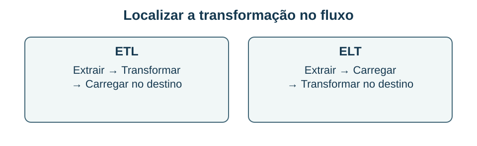

## Mover dados sem perder significado nem controle {#bd17}

**Objetivo BD-17 — item 17:** distinguir ETL e ELT e avaliar integração por arquivos, acesso a bases, lotes e captura de mudanças.

**Ingestão** recebe dados de uma origem; **integração** organiza dados de diferentes origens para um uso coerente. Copiar bytes pode concluir uma transferência, mas ainda deixar nomes, unidades, chaves e períodos incompatíveis. A tarefa exige interpretar estrutura e significado, conferir qualidade e registrar o percurso dos dados.

Em **ETL**, extraímos, transformamos e carregamos no destino definido para o processo. Em **ELT**, extraímos, carregamos e transformamos usando a capacidade do ambiente de destino. A diferença está na posição da transformação em relação à carga considerada. Não significa que ETL sempre processe dados menores ou que ELT seja automaticamente mais rápido. Volume, processamento, custos, segurança e requisitos de qualidade precisam ser avaliados.

### Arquivos e integração via base

A transferência de arquivos exige um contrato: formato, codificação, delimitador, tipos, versão do esquema, identificação do lote e regra para arquivos incompletos. Conferir o hash ajuda a verificar se os bytes recebidos são os esperados; não comprova, por si só, que os dados descrevam o negócio corretamente. Um arquivo íntegro pode estar desatualizado ou ter sido gerado com uma regra errada.

A integração via base pode usar consultas, tabelas de apoio ou mecanismos de captura. É preciso considerar permissões, impacto na origem e consistência da leitura. Ler tabelas em instantes incompatíveis pode combinar estados que nunca existiram juntos. Uma carga completa copia o conjunto definido; uma carga incremental procura o que mudou desde um ponto de controle.

### Incrementos, CDC e reprocessamento

Uma coluna de atualização pode apoiar uma carga incremental, mas requer cuidado com precisão temporal, transações concorrentes, atrasos e exclusões. Um marcador “último horário lido” não resolve automaticamente todos esses casos. **CDC**, captura de mudanças, registra ou disponibiliza alterações por mecanismos como logs, conforme o produto. No PostgreSQL, a decodificação lógica possui posições e recursos próprios; após certas falhas, mudanças recentes podem ser reenviadas, e o consumidor precisa tratar repetições.

Um consumidor **idempotente** pode receber novamente a mesma unidade lógica sem produzir um efeito adicional indevido. Isso normalmente exige uma identidade adequada, como evento_id, e uma política de gravação. A promessa de entrega “exatamente uma vez” não deve ser inferida apenas porque uma ferramenta tem checkpoint. A garantia depende do fluxo completo, incluindo origem, destino e efeitos externos.

### Exemplo resolvido: duas tentativas do mesmo lote

Um lote contém os eventos de matrícula `e1`, `e2` e `e3`. A primeira tentativa grava `e1` e `e2` e falha antes da conclusão. Uma segunda tentativa entrega novamente os três. Se a carga apenas acrescenta linhas sem controle, o destino pode ficar com cinco registros para três eventos. Se usa identidade e política idempotente, reconhece `e1` e `e2` e aplica apenas o efeito ainda necessário de `e3`.

**Conferência:** contar três eventos distintos não significa ignorar alterações posteriores legítimas. Uma nova versão de um evento, uma correção e um cancelamento precisam de regras. A chave de deduplicação deve identificar a unidade certa; deduplicar apenas por aluno eliminaria matrículas diferentes da mesma pessoa.

### Qualidade e observação

Valide esquema, tipos, referências e regras de negócio; separe registros inválidos com motivo e mantenha possibilidades de correção e reprocessamento. Registre contagens, rejeições, horários, versão e ponto de retomada. Essas informações são metadados de processo e apoiam a auditoria. O objetivo é explicar o resultado, e não apenas terminar com um indicador verde.

**Recupere:** desenhe ETL e ELT indicando qual destino está sendo considerado. Depois explique como evitar duplicação em uma repetição de lote e por que um checksum correto não dispensa validação semântica.

**Fontes:** F14, F15 e F16; P24, item 67. A discussão de CDC identifica o PostgreSQL quando descreve seu comportamento, sem generalizar a todos os produtos.
