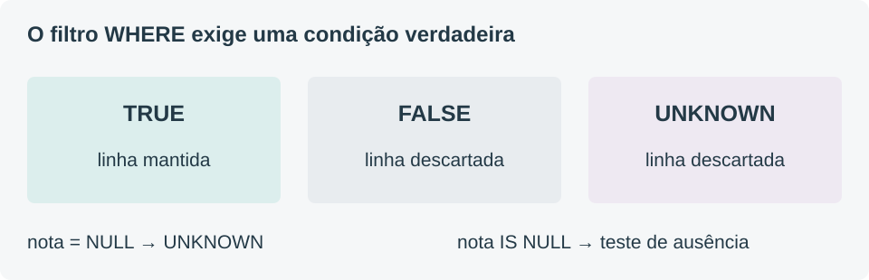

## Junção não é uma escolha de uma única linha {#juncoes}

Uma junção combina linhas que satisfazem uma condição. No INNER JOIN, entram apenas as combinações correspondentes. No LEFT JOIN, cada linha da esquerda é preservada; se não houver correspondência à direita, as colunas desse lado aparecem como NULL. Isso não cria uma matrícula real para o aluno sem matrícula. [Fonte T02](#fonte-t02)

```sql
SELECT a.nome, m.curso_id
FROM Aluno a
JOIN Matricula m ON m.aluno_id = a.id
ORDER BY a.id, m.curso_id;
```

**Resultado explicado:** Ana combina com duas matrículas e gera duas linhas. Beto e Caio geram uma linha cada. Dora não encontra correspondência e não aparece. O total é quatro linhas, apesar de haver quatro alunos no cadastro. A coincidência entre esses totais é acidental: não prova que houve uma linha por aluno.

Ao usar SELECT DISTINCT a.nome, os dois nomes Ana se tornam uma única linha projetada. DISTINCT remove repetições do resultado selecionado; ele não corrige uma condição de junção errada nem garante que nomes identifiquem pessoas. Dois alunos homônimos poderiam ser indevidamente confundidos se o nome fosse a única coluna examinada. [Fonte T03](#fonte-t03)

## ON e WHERE respondem perguntas diferentes {#filtros}

Compare “liste todos os alunos e suas matrículas ativas, se existirem” com “liste as combinações que possuem matrícula ativa”. A primeira formulação exige preservar alunos sem correspondência ativa. A segunda aceita descartá-los.

```sql
-- Preserva todos os alunos.
SELECT a.nome, m.curso_id
FROM Aluno a LEFT JOIN Matricula m
  ON m.aluno_id = a.id AND m.status = 'ativa'
ORDER BY a.id;
```

O resultado contém Ana/10, Beto/10, Caio/20 e Dora/NULL. A condição no ON define quais matrículas podem corresponder a cada aluno. Dora permanece porque o operador é externo à esquerda.

Se m.status = 'ativa' for movido para WHERE, depois de uma junção sem esse filtro no ON, a linha preservada de Dora terá m.status NULL. A comparação não será verdadeira e essa linha será descartada. Não é uma regra de estilo: a mudança altera a pergunta e o resultado. [Fonte T04](#fonte-t04)


## NULL não significa zero {#nulos}

NULL representa ausência de valor, não um número ou uma palavra reservada que se compare por igualdade comum. No exemplo, Caio tem uma matrícula ativa, mas ainda não possui nota. Dar nota zero a Caio seria registrar um resultado acadêmico; deixá-la NULL informa que o valor está ausente. São situações diferentes.

As comparações usuais com NULL produzem resultado desconhecido. Por isso, nota = NULL não seleciona as linhas com nota ausente. Use nota IS NULL ou nota IS NOT NULL. WHERE conserva as linhas cuja condição é verdadeira; as condições falsas ou desconhecidas não passam pelo filtro. [Fontes T05](#fonte-t05) e [T06](#fonte-t06)



```sql
SELECT aluno_id, curso_id
FROM Matricula
WHERE nota IS NULL
ORDER BY aluno_id, curso_id;
```

O resultado é (1,20) e (3,20). A consulta identifica a nota ausente de Ana em Redes e a nota ausente de Caio em Redes. Não encontra Dora porque a consulta parte de Matricula, e Dora não tem uma linha ali. Para encontrar alunos sem matrícula, é necessário partir de Aluno e testar a ausência de correspondência, por exemplo com LEFT JOIN e uma coluna obrigatória da tabela da direita.

## Contar linhas não é contar valores preenchidos {#agregacoes}

COUNT(*) conta as linhas consideradas pelo grupo. COUNT(expressao) conta apenas as linhas nas quais essa expressão não é NULL. AVG e MAX trabalham com os valores não nulos; a média não transforma uma nota ausente em zero. Sobre um conjunto sem valores aplicáveis, COUNT retorna zero, enquanto MAX retorna NULL. [Fonte T07](#fonte-t07)

```sql
SELECT a.nome, COUNT(*) AS linhas,
       COUNT(m.curso_id) AS matriculas
FROM Aluno a LEFT JOIN Matricula m
  ON m.aluno_id = a.id
GROUP BY a.id, a.nome
ORDER BY a.id;
```

| Nome | Linhas | Matrículas |
|---|---|---|
| Ana | 2 | 2 |
| Beto | 1 | 1 |
| Caio | 1 | 1 |
| Dora | 1 | 0 |

**Por que Dora tem 1 e 0?** O LEFT JOIN preserva uma linha para Dora. COUNT(*) a conta. Nessa linha, m.curso_id está NULL; COUNT(m.curso_id) não a conta. Como curso_id é obrigatório nas matrículas reais, ele serve para identificar correspondência. Usar COUNT(m.nota) responderia outra pergunta: quantas matrículas têm nota preenchida.

## Agrupe primeiro; filtre grupos depois {#agrupamento}

GROUP BY reúne as linhas por um critério, e as funções de agregação resumem cada grupo. WHERE atua sobre as linhas que entram no agrupamento; HAVING atua sobre os grupos formados. Uma consulta que pede alunos com duas matrículas deve contar matrículas por aluno e comparar essa contagem no HAVING. [Fonte T08](#fonte-t08)

```sql
SELECT aluno_id, COUNT(*) AS quantidade
FROM Matricula
GROUP BY aluno_id
HAVING COUNT(*) >= 2
ORDER BY aluno_id;
```

Somente Ana aparece, com quantidade 2. Se o pedido fosse “duas matrículas ativas”, seria necessário aplicar WHERE status = 'ativa' antes do agrupamento. Nessa massa, nenhum aluno alcançaria duas matrículas ativas.

Para estudar uma consulta, siga a transformação lógica: origem e junções, filtro de linhas, agrupamento, filtro de grupos, projeção e ordenação. Essa sequência ajuda a raciocinar sobre resultados; não obriga o otimizador a executar fisicamente nessa ordem. Diferenciar semântica e plano físico evita uma generalização comum.

## Subconsulta escalar e conjunto vazio {#subconsulta}

Uma subconsulta escalar fornece um valor à expressão que a contém. Quando há correlação, uma referência à linha externa define quais dados a subconsulta considera. Em uma agregação sem GROUP BY, MAX pode produzir um único resultado NULL mesmo quando não existem linhas correspondentes. Isso é diferente de pular a atualização. [Fontes T10](#fonte-t10) e [T11](#fonte-t11)

```sql
UPDATE Aluno
SET nota_maxima = (
  SELECT MAX(m.nota)
  FROM Matricula m
  WHERE m.aluno_id = Aluno.id
);
```

Neste exemplo, o comando externo não possui WHERE. Logo, todos os alunos são alvos da atualização. Ana recebe 8, Beto recebe 6, Caio recebe NULL porque suas notas aplicáveis estão ausentes, e Dora recebe NULL porque não possui matrícula. Um valor antigo de nota_maxima não é preservado apenas pela falta de correspondência.

Se o requisito for preservar valores antigos para alunos sem matrícula, a condição precisa ser expressa, por exemplo restringindo as linhas atualizadas. Se o requisito for representar ausência por um valor de exibição, a conversão deve ser uma decisão explícita. Não usar zero automaticamente como sinônimo de “não informado”.
