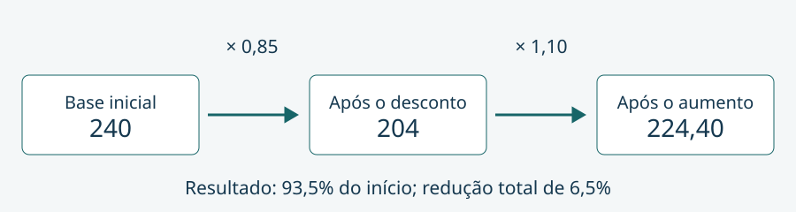

## A mesma taxa pode produzir resultados diferentes {#porcentagens}

Ao ler que uma quantidade caiu 15% e depois cresceu 10%, identifique primeiro a base de cada operação. A porcentagem representa uma fração de cem partes, mas essas partes pertencem a uma quantidade concreta. Dez por cento de 204 e dez por cento de 240 não representam o mesmo valor.

Nosso objetivo é calcular mudanças sucessivas, distinguir taxa relativa de pontos percentuais e conferir se o resultado faz sentido. Como pré-requisito, basta multiplicar números decimais e interpretar uma fração. O material é uma demonstração autoral do método editorial; não está vinculado a um edital ou perfil de banca.

### Do percentual ao fator multiplicativo

Considere um valor inicial de 240 unidades monetárias. Um desconto de 15% retira quinze centésimos desse valor: 36 unidades. Restam 204. Em vez de calcular a parte retirada e depois subtrair, podemos reunir as duas operações em um fator:

$$V_1 = V_0\left(1-\frac{15}{100}\right)=240\cdot 0{,}85=204.$$

Em palavras: multiplicar por 0,85 conserva 85 de cada 100 partes da base. Um aumento de 10%, por sua vez, conserva a base inteira e acrescenta um décimo dela, correspondendo ao fator 1,10. Taxas percentuais devem ser convertidas para frações ou decimais antes da operação.

### Exemplo resolvido: duas mudanças em sequência

Após o desconto, o valor 204 sofre aumento de 10%. A base dessa segunda mudança já é 204. O acréscimo vale 20,40 e o resultado é 224,40. A Figura 1 identifica os valores que entram em cada etapa.

$$V_f=240\cdot 0{,}85\cdot 1{,}10=224{,}40.$$

A conferência pode ser feita pelo produto dos fatores: 0,85 vezes 1,10 resulta em 0,935. Portanto, restam 93,5% do valor de partida, uma redução total de 6,5%. Somar as taxas com sinais daria redução de 5%, o que produziria 228 e não representaria a segunda base corretamente.

Não é preciso decorar um resultado para cada combinação. Escreva a base inicial, transforme cada mudança em fator e multiplique na ordem do cenário. A multiplicação dos fatores é comutativa quando as mesmas taxas se aplicam integralmente e não há arredondamento intermediário, piso ou regra adicional; essas condições precisam ser lidas no problema.

### Pontos percentuais e variação relativa

Uma taxa passou de 12% para 15%. A diferença entre os percentuais é de **3 pontos percentuais**. Já o crescimento relativo da taxa usa 12 como referência:

$$\frac{15-12}{12}=\frac{1}{4}=25\%.$$

Os dois números respondem a perguntas diferentes: quanto a taxa se deslocou na escala percentual e quanto esse deslocamento representa em relação à taxa anterior. Ao escrever uma resposta, indique a unidade adequada. A subtração isolada não fornece o crescimento relativo.

### Reverter uma redução exige olhar a nova base

Uma quantidade passou de 200 para 180 após cair 10%. Para voltar a 200, é preciso acrescentar 20 sobre a base 180:

$$r=\frac{200-180}{180}=\frac{1}{9}\approx 11{,}11\%.$$

A verificação por multiplicação confirma: 180 vezes dez nonos é 200. O percentual necessário para retornar não coincide com os 10% retirados da base original. Evite arredondar o fator antes da última etapa; quando a pergunta exigir duas casas decimais, arredonde a resposta final.

**Prática:** as questões Q-AUT-001, Q-AUT-002 e Q-AUT-006 retomam esses raciocínios, com alternativas e comentários no fim do material. Referência conceitual consultada: fonte M01; situações, valores, figura e redação são próprios.
