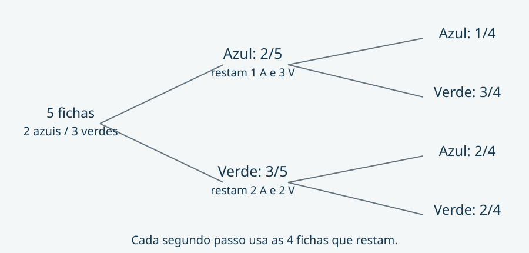

## Contar resultados antes de dividir {#probabilidade}

Quando todos os resultados elementares têm a mesma chance, a probabilidade de um evento é a razão entre resultados favoráveis e resultados possíveis. A condição de equiprobabilidade faz parte da regra: contar categorias sem conferir as chances pode produzir uma fração incorreta.

Imagine cinco fichas indistinguíveis ao tato: duas azuis e três verdes. Cada ficha tem a mesma chance de ser retirada. Para organizar a contagem, dê nomes às fichas azuis, A1 e A2, e às verdes, V1, V2 e V3. Esses nomes são apenas etiquetas de raciocínio.

Na primeira retirada, a chance de azul é dois quintos: há duas fichas favoráveis entre cinco igualmente possíveis. Ela não é um meio por haver duas cores. As cores agrupam quantidades diferentes de resultados elementares.

### Duas retiradas sem reposição

Queremos a probabilidade de retirar duas azuis, uma depois da outra, **sem devolver a primeira**. Se a primeira foi azul, restam quatro fichas, das quais apenas uma é azul. A Figura 2 mostra as probabilidades do segundo passo condicionadas ao primeiro.

O caminho azul seguido de azul tem probabilidade:

$$P(AA)=\frac{2}{5}\cdot\frac{1}{4}=\frac{1}{10}=10\%.$$

Em palavras: a primeira fração descreve o início do caminho; a segunda usa apenas o cenário em que o primeiro passo foi azul. Não se está supondo independência. Sem reposição, a composição do conjunto muda.

### Conferência por enumeração

Há cinco escolhas para a primeira ficha e quatro para a segunda. Os vinte pares ordenados são igualmente prováveis. Apenas dois deles são favoráveis: A1 seguida de A2 e A2 seguida de A1. A razão dois sobre vinte confirma um décimo.

Com reposição e nova mistura adequada, a segunda retirada voltaria a ter duas azuis entre cinco fichas. A probabilidade das duas azuis seria então quatro vinte e cinco avos, ou 16%. Esse resultado descreve outro experimento; por isso é um distrator plausível quando o enunciado diz sem reposição.

Se a pergunta tratasse de exatamente uma azul, seria preciso reunir os caminhos azul–verde e verde–azul, que são mutuamente exclusivos. Na figura, cada um vale três décimos; juntos, seis décimos. Observar o evento pedido evita calcular apenas uma parte da resposta.

### Recuperação ativa

Antes de abrir os comentários de Q-AUT-004, explique por que o segundo denominador vale quatro. Depois tente conferir o resultado contando os pares favoráveis. As duas estratégias devem concordar porque representam o mesmo experimento.

Este recorte não trata de distribuições contínuas, inferência ou contagem avançada. A definição elementar foi conferida na fonte M02. Fichas, árvore e questões são originais, sem atribuição a concurso ou banca.

### Glossário do recorte

- **Base:** quantidade usada como referência em uma taxa.
- **Fator multiplicativo:** número que transforma a base em um valor após uma mudança.
- **Ponto percentual:** unidade da diferença entre duas taxas expressas em porcentagem.
- **Média aritmética:** total dos valores dividido pelo número de observações.
- **Equiprobabilidade:** condição em que os resultados elementares têm a mesma chance.
- **Sem reposição:** a ficha retirada não retorna ao conjunto antes da retirada seguinte.
