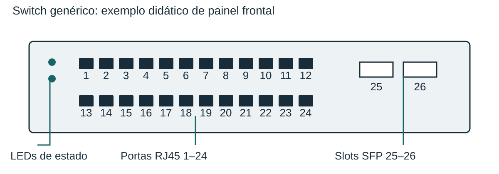

## Porta física e informação de encaminhamento {#portas-mac}

Um switch de camada 2 conecta segmentos de uma rede local e encaminha quadros a partir de informações de endereços MAC. A porta física é uma interface do equipamento. O endereço MAC identifica uma interface de rede; não deve ser confundido com o número impresso em uma porta do painel.

Quando aprende um endereço de origem, o equipamento relaciona esse endereço à porta por onde viu o quadro. A RFC 4188 descreve essa associação no objeto dot1dTpFdbPort. Para um destino conhecido, a informação de encaminhamento indica a porta correspondente. Se o destino não estiver aprendido, o comportamento de inundação depende do domínio de camada 2 e dos controles existentes; isso não equivale a enviar sempre todo quadro por todas as portas.

A figura separa três grupos. À esquerda, LEDs oferecem indicação de estado, cujo significado exige o manual real. As duas fileiras centrais representam 24 portas RJ45. À direita, dois slots SFP recebem módulos compatíveis com o equipamento. RJ45 descreve o conector do exemplo: sozinho, não comprova velocidade ou alimentação PoE. Um slot SFP também não garante compatibilidade irrestrita com qualquer módulo.

### Exemplo resolvido

Considere um quadro que entra pela porta 1 e cujo MAC de destino está associado à porta 7. Primeiro, separe origem e destino: a porta 1 descreve a entrada, e não a saída desejada. Depois, consulte a associação do destino. A decisão esperada no cenário simples é encaminhar à porta 7. A conferência consiste em explicar por que a porta de entrada não substitui a consulta ao destino.
